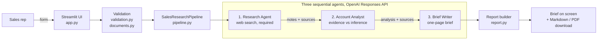

# CAP 931 — Sales Agent Prototype Using Multi-Agent GPT Models

**Author:** Bolivar Vega · **Course:** CAP 931 Capstone · **Status:** Working local prototype · **Tests:** 10/10 passing

A Streamlit app that helps a new sales representative research a prospective account. Three GPT agents run in sequence (**Research → Account Analyst → Brief Writer**) and produce a one-page, source-linked account brief that can be downloaded as Markdown or PDF.

The app is built to be honest about what it knows. Every claim links to a source, inferences are labeled, and anything the agents could not find is listed as an unknown instead of being guessed.

---

## Presentation roadmap

Use this order for the talk. Each step links to the section below that supports it.

| # | Topic | Talking point | Time |
|---|---|---|---|
| 1 | [The problem](#1-the-problem) | New reps waste hours on account research and can't tell fact from guesswork | 1 min |
| 2 | [The solution](#2-the-solution) | Three focused agents turn a short form into a sourced one-pager | 1 min |
| 3 | [Live demo](#3-live-demo-script) | Fill the form → run → show brief, sources, downloads | 3 min |
| 4 | [Architecture](#4-architecture) | How the agents hand work to each other | 2 min |
| 5 | [Model and prompt design](#5-model-choice-and-prompt-engineering) | Why one model, three prompts, bounded outputs | 1 min |
| 6 | [Safety and validation](#6-input-handling-and-safety) | URL checks, file limits, untrusted web content, no stored data | 1 min |
| 7 | [Results and experiments](#7-results-and-experiments) | Target Corporation case study; what changed between runs | 2 min |
| 8 | [Challenges](#8-challenges-and-solutions) | Mismatched competitors, unverified claims, missing buyer | 1 min |
| 9 | [Testing](#9-testing) | 10 offline tests, no API key needed | 30 s |
| 10 | [Deployment and next steps](#10-production-deployment-plan) | How it would go to production; what I'd build next | 1 min |
| 11 | [Rubric coverage](#11-how-the-project-meets-the-assignment) | Each grading criterion and where it's met | 30 s |

---

## 1. The problem

A new sales rep preparing for a prospect needs answers to four questions:

1. What is this company's strategy in my product area?
2. Do they mention or use my competitors?
3. Who are the leaders I should know about?
4. Where can I verify all of this?

Finding these answers by hand takes hours. A single chatbot prompt is fast, but it often blends facts with confident guesses and gives no sources.

## 2. The solution

A local web app where the rep enters the product, the prospect, and competitors, then clicks **Research account**. Three agents, each with one job, produce a brief with these sections:

- **Account snapshot**
- **Strategy signals**
- **Competitor mentions**
- **Relevant leadership**
- **Suggested sales angle**
- **Unknowns to verify**
- **Sources** (clickable links)

Separating the work into three roles means each prompt can be short and strict. Only the Research Agent uses the web. The other two agents work from its notes and source list and are told not to add outside facts.

## 3. Live demo script

Before the presentation, check that `.env` has a valid `OPENAI_API_KEY` and run `uv run pytest` once.

1. Start the app: `uv run streamlit run app.py`, then open `http://localhost:8501`.
2. Fill the form with the case-study inputs:

   | Field | Value |
   |---|---|
   | Product name | Base Ball Bats |
   | Product category | Sport |
   | Value proposition | The best wooden bat in the market |
   | Company name | Target Corporation |
   | Company URL | `https://corporate.target.com/` |
   | Competitor URLs | Marucci, Mizuno, Victus sites (one per line) |
   | Target contact / overview file | Leave blank |

3. Click **Research account**. A live run takes about a minute because it makes three model calls plus web search.
4. Point out in the result:
   - Inline source links on every factual line
   - Lines marked **Inference**
   - The "best wooden bat" claim flagged as unsubstantiated
   - "Category buyer not found" under Unknowns
5. Click **Download PDF** to show the one-page brief.
6. **Optional:** enter `http://localhost` as the company URL to show the validation error.

**Backup plan:** if the network or API fails during the talk, open the saved output in [docs/outputs/sales_account_brief.pdf](docs/outputs/sales_account_brief.pdf) or the screenshot in [docs/evidence/generated-brief.png](docs/evidence/generated-brief.png).

## 4. Architecture



### The three agents

| Agent | Input | Job | Tools | Output cap |
|---|---|---|---|---|
| **Research Agent** | Form data + optional product overview | Find public evidence from primary sources (company site, press releases, investor relations, filings, leadership pages, job postings) | `web_search` (required) | 2,200 tokens |
| **Account Analyst** | Research notes + source list only | Separate evidence from inference, find gaps; four sections: strategy, competitors, leaders, opportunities and unknowns | None | 1,400 tokens |
| **Brief Writer** | Analysis + source list only | Write the one-page brief with inline `[Source](URL)` citations | None | 900 tokens |

Source URLs come from the web-search citation annotations in the API response, not from text the model writes. Each agent raises a clear error if it returns nothing.

### Code map

```
capstone-931/
├── app.py                      # Streamlit UI: form, validation, run, display, downloads
├── src/sales_agent/
│   ├── pipeline.py             # The 3 agents + SalesResearchPipeline orchestrator
│   ├── validation.py           # Public-URL checks, competitor list parsing (max 5, de-duplicated)
│   ├── documents.py            # Text extraction from .txt/.md/.pdf/.docx (5 MB, 20k chars)
│   └── report.py               # Markdown and PDF (ReportLab) report builders
├── tests/                      # 10 offline tests (fake API client, no network)
├── docs/
│   ├── outputs/                # Generated brief (MD + PDF), final report, evidence checklist
│   ├── evidence/               # Screenshots: generated brief, passing tests
│   ├── EXPERIMENT_LOG.md       # Run-by-run comparison
│   ├── TIME_LOG.csv            # Time allocation
│   ├── progress-guide/         # Reusable student process guide
│   └── reference/              # Original assignment and report template (unchanged)
├── .ai/                        # Project rules, architecture, mission, decisions
├── pyproject.toml / uv.lock    # Dependencies (managed with uv)
└── .env.example                # Template for the local API key
```

**Tech stack:** Python 3.11+, Streamlit, OpenAI Python SDK (Responses API + web search), pypdf, python-docx, ReportLab, pytest, ruff, uv.

## 5. Model choice and prompt engineering

**Model.** All three roles use one configurable model, set by `OPENAI_MODEL` in `.env` (default `gpt-6-luna`). It was chosen as a cost-sensitive option that supports the Responses API with web search. Using one model across both runs kept the experiments comparable. No model benchmark for cost, speed, or accuracy was run, so this project does not claim it is the best model.

**Prompt techniques used:**

- **Chaining:** each agent's output becomes the next agent's only input.
- **Role restriction:** each prompt has one job and a fixed output format, which keeps the agent on the sales-research task.
- **Grounding rules:** "Use only the packet and source list; do not add outside facts."
- **Evidence labeling:** separate sourced facts from inferences, and mark inferences explicitly.
- **Anti-hallucination:** "Do not invent names, quotes, dates, or competitor relationships." Say "not found" when evidence is missing.
- **Literal competitor handling:** don't imply a partnership or rivalry unless the evidence says so.
- **Prompt-injection defense:** website text and uploaded files are treated as untrusted data, not instructions.
- **Bounded output:** token caps on every call keep the brief to one page and limit cost.

## 6. Input handling and safety

| Area | What the app does |
|---|---|
| Required fields | Product name, category, value proposition, and company name must be filled in. Errors name each missing field. |
| Company and competitor URLs | Must be `http`/`https`. Rejects `localhost`, `.local` hosts, and private or reserved IP addresses. |
| Competitors | Up to 5 URLs, duplicates removed |
| Product overview upload | `.txt`, `.md`, `.pdf`, `.docx`; 5 MB limit; text capped at 20,000 characters; empty or unreadable files rejected |
| URL fetching | The server never fetches user URLs directly. They are passed to the model as research targets for web search, which avoids server-side request forgery. |
| Secrets | API key read from local `.env`, which is git-ignored. Error messages never show the key or request headers. |
| Data retention | No database and nothing written to disk. Results live only in the browser session. |
| Cost control | No API calls until the user submits. Output tokens are capped per agent. |

## 7. Results and experiments

### Case study: wooden baseball bats → Target Corporation

The final brief ([Markdown](docs/outputs/sales_account_brief.md) · [PDF](docs/outputs/sales_account_brief.pdf)) found:

- **Strategy:** Target's 2026 growth plan and 2025 annual report highlight differentiated assortments, value, and youth-sports essentials as in-store categories.
- **Competitors:** Target's wood-bat listings include Marucci and Mizuno. The Victus listing is sold by a third-party seller. These are correctly described as retail listings, not strategic relationships.
- **Leadership:** Cara Sylvester (Chief Merchandising Officer) as the most relevant executive; the CEO and Chief Information & Product Officer for context.
- **Honest gaps:** category buyer not found; the "best wooden bat" claim flagged as unsubstantiated.
- **Sources:** 9 linked sources, mostly primary sources from Target's own sites.

### Experiment log (summary of [docs/EXPERIMENT_LOG.md](docs/EXPERIMENT_LOG.md))

| Run | Change | Relevance (1–5) | Grounding (1–5) | Lesson |
|---|---|---:|---:|---|
| 1 | Competitors: Snowflake, Databricks (wrong industry) | 2 | 4 | Bad inputs produce irrelevant output, even when grounding is good |
| 2 | Competitors: Marucci, Mizuno, Victus (matched) | 4 | 4 | Matching the inputs to the product doubled relevance |

**Takeaway:** grounding stayed strong in both runs, which shows the prompts kept the model honest. Relevance depended on input quality.

**Not yet done:** a single-prompt baseline to compare against the three-agent chain. It is planned, so no claim is made that the chain beats a single prompt.

## 8. Challenges and solutions

| Challenge | Solution |
|---|---|
| The first competitor inputs (Snowflake, Databricks) didn't match a baseball-bat product | Replaced them with Marucci, Mizuno, and Victus and re-ran |
| "Best wooden bat" couldn't be verified | The brief labels it an unsubstantiated seller claim instead of stating it as fact |
| No category buyer could be found | Recorded under "Unknowns to verify" instead of guessing a name |
| The first brief's sales-angle sentence ended abruptly | Reviewed the output and kept the complete second-run version |
| Testing AI code without spending credits | Injected a fake API client so the pipeline test runs offline |

## 9. Testing

```bash
uv run pytest
# 10 passed in 0.01s
```

| Test file | What it checks |
|---|---|
| `test_pipeline.py` | All three agents run in order, the Research Agent uses web search, and sources pass through to the result |
| `test_validation.py` | Valid public URLs accepted; empty, scheme-less, `file://`, `localhost`, and `127.0.0.1` rejected; competitor de-duplication and 5-URL limit |
| `test_documents.py` | Text extraction works; unsupported and empty files rejected |

The tests need no API key and no network. Evidence: [docs/evidence/tests-passing.png](docs/evidence/tests-passing.png).

## 10. Production deployment plan

This is a plan. The prototype runs locally and has not been deployed.

- **Hosting:** a managed container service such as Streamlit Community Cloud, Cloud Run, or Azure App Service, behind HTTPS.
- **Security:** user sign-in (SSO), the API key kept in the host's secrets manager, the existing URL and file validation, and rate limits per user.
- **Scalability:** the app has no stored state, so more instances can be added behind a load balancer. Long research runs could move to a background job queue.
- **Cost and monitoring:** per-run token logging, spend alerts, and error tracking with secrets redacted.
- **Maintenance:** dependency updates, CI running `pytest` and `ruff` on every change, and regular checks of source quality and brief accuracy.

### Future improvements (proposed, not built)

- **Claim checker:** confirm every sentence has a source before allowing download.
- **Completeness check:** flag cut-off or missing sections automatically.
- **Single-prompt baseline and model comparison:** measure the benefit of the chain using the same inputs.
- **Email alert system:** watch press releases and job postings for keywords chosen by the rep.
- **Meeting deck generator:** turn the brief into slides for the sales call.

## 11. How the project meets the assignment

| Rubric criterion | Where it's met |
|---|---|
| **Technical setup** | `uv` environment, `.env` key handling, Streamlit app, setup steps below |
| **Inputs handling** | All required inputs plus optional contact and file upload; validation in `validation.py` and `documents.py`; tests |
| **LLM selection and use** | Configurable model with stated reasoning; three-agent prompt chain with grounding rules (sections 4–5) |
| **Data integration and output** | Required web search with primary-source priority; one-page brief covering strategy, competitors, leadership, sources |
| **Optional enhancements** | Output-accuracy controls (evidence vs inference, unknowns, citations) built in; alert system proposed |
| **Production deployment** | Plan covering scalability, security, maintenance (section 10) |
| **Documentation** | This README, [final report (PDF)](docs/outputs/CAP_931_Report_Bolivar_Vega.pdf), [experiment log](docs/EXPERIMENT_LOG.md), [time log](docs/TIME_LOG.csv), [.ai/](.ai/) design records |

### Time allocation (from [docs/TIME_LOG.csv](docs/TIME_LOG.csv); estimated afterward)

| Task | Minutes |
|---|---:|
| Environment setup and API configuration | 45 |
| Prototype build and troubleshooting | 120 |
| Research runs and output review | 45 |
| Testing and documentation | 60 |
| **Total** | **270 (4.5 h)** |

---

## Setup and run

**Requirements:** Python 3.11+, [`uv`](https://docs.astral.sh/uv/), and an OpenAI API key with access to the Responses API and web search.

```bash
# 1. Install dependencies
uv sync

# 2. Create your local env file, then set OPENAI_API_KEY inside it
cp .env.example .env

# 3. Run the app (opens at http://localhost:8501)
uv run streamlit run app.py

# 4. Run the offline tests (no API key needed)
uv run pytest
```

Optional: set `OPENAI_MODEL` in `.env` to use a different model. Never commit `.env`.

## Scope and limitations

- Local, single-user prototype: no database, alerts, or public deployment.
- Web search may not index every URL entered. The brief only reflects what search returned.
- The PDF lists up to 8 sources; the Markdown download lists all of them.
- AI output can still be wrong. Check sources before contacting a customer.

## Further reading

- [Final report (PDF)](docs/outputs/CAP_931_Report_Bolivar_Vega.pdf)
- [Original assignment](docs/reference/)
- [Student process guide](docs/progress-guide/CAP_931_Student_Process_Guide.md): a reusable workflow for future students
- [Architecture](.ai/ARCHITECTURE.md) · [Decisions](.ai/DECISIONS.md) · [Rules](.ai/RULES.md)
